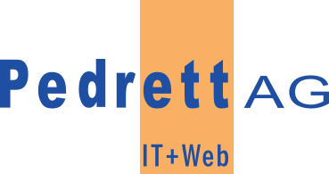

<p align="center">
  
</p>

<p align="center">
  
</p>

<h1 align="center">ALSO Cloud Marketplace MCP</h1>

<p align="center">
  <strong>MCP Server for ALSO Cloud Marketplace</strong><br/>
  Companies · Subscriptions · Users · Invoices · Azure RI / Savings Plans
</p>

<p align="center">
  <a href="README.md">English</a> · <a href="README.de.md">Deutsch</a>
</p>

<p align="center">
  <a href="https://modelcontextprotocol.io"></a>
  <a href="LICENSE"></a>
  <a href="https://nodejs.org"></a>
  <a href="package.json"></a>
  <a href="https://www.pitw.ch"></a>
</p>

---

## Overview

This MCP server connects AI assistants (Cursor, Claude, Gemini CLI, Codex, …) to the [ALSO Cloud Marketplace Simple API](https://app.swaggerhub.com/apis-docs/MarketplaceSimpleAPI/MarketplaceSimpleAPI/1.0.0). Natural-language requests are translated into API calls — locally over stdio, using the same auth and marketplace rules as the [go-also-cloud-wrapper](https://github.com/pitwch/go-also-cloud-wrapper).

| | |
|---|---|
| **Protocol** | [Model Context Protocol](https://modelcontextprotocol.io) (stdio) |
| **API** | MarketplaceSimpleAPI 1.0.0 |
| **Stack** | TypeScript · Node.js 20+ |
| **Tools** | ~60 endpoints + workflow tools |

### Highlights

- Workflow tools for common reseller questions (`find_companies`, `list_company_subscriptions`, …)
- Compact responses by default — raw data only with `fullDetail=true`
- Azure RI / Savings Plans including catalog enums and order dry-run
- Readable ALSO errors including support tokens on 500s
- Escape hatches: `api_read` / `api_request` for rarely used endpoints

---

## Table of contents

- [Quick start](#quick-start)
- [Configuration](#configuration)
- [Client setup](#client-setup)
- [Usage](#usage)
- [Tools](#tools)
- [Development](#development)
- [Links](#links)
- [License & provider](#license--provider)

---

## Quick start

```bash
git clone https://github.com/pitwch/also-cloud-marketplace-mcp.git
cd also-cloud-marketplace-mcp
npm install
npm run build
```

Then set credentials (see [Configuration](#configuration)) and register the server in your MCP client.

**Recommended (built):**

```text
command: node
args:    [<REPO>/dist/index.js]
```

**Alternative without build (tsx):**

```text
command: npx
args:    [tsx, <REPO>/src/index.ts]
```

Prerequisite for tsx: run `npm install` in the repo first.

---

## Configuration

| Variable | Example | Required |
|----------|---------|----------|
| `ALSO_CLOUD_MARKETPLACE` | `Switzerland` or `https://marketplace.also.ch` | yes |
| `ALSO_CLOUDUSER` | `you@example.com` | yes |
| `ALSO_CLOUDPW` | `••••••••` | yes |
| `ALSO_CLOUD_TIMEOUT_MS` | `30000` | no |
| `ALSO_CLOUD_API_PREFIX` | `/SimpleAPI/.../rest` | no |
| `ALSO_CLOUD_PARENT_ACCOUNT_ID` | `123456` | no |
| `ALSO_CLOUD_ALLOW_REMOTE_PRICING` | `false` | no |

`ALSO_CLOUD_MARKETPLACE` accepts a **full URL** or a **country key**: `Switzerland`, `Germany`, `Austria`, `Debug`, …

Without `ALSO_CLOUD_PARENT_ACCOUNT_ID`, the own account is detected automatically (`get_my_account`).

Set `ALSO_CLOUD_ALLOW_REMOTE_PRICING` only if ALSO enables RI/Savings Plan orders via the Simple API — otherwise `validate_subscription_fields` / `create_subscription` redirect to `order_azure_reservation`.

### Note: 2FA

ALSO Cloud accounts have **2FA enabled by default**. The Simple API and this MCP only support username + password. For API/MCP use, disable 2FA for the account via the **ALSO support portal**.

---

## Client setup

Everywhere: start the server locally (stdio) and pass credentials as `env`.  
Replace `<REPO>` with your clone path, e.g. `C:/DEV/also-cloud-marketplace-mcp`.

<details>
<summary><strong>Cursor</strong></summary>

1. **Settings → MCP → Add new MCP server** (or edit `mcp.json`)
2. Add:

```json
{
  "mcpServers": {
    "also-cloud": {
      "command": "node",
      "args": ["C:/DEV/also-cloud-marketplace-mcp/dist/index.js"],
      "env": {
        "ALSO_CLOUD_MARKETPLACE": "Switzerland",
        "ALSO_CLOUDUSER": "you@example.com",
        "ALSO_CLOUDPW": "your-password"
      }
    }
  }
}
```

3. Enable the server / reload Cursor
4. Use `also-cloud` tools in chat, e.g. *“List companies under parent 12345”*

</details>

<details>
<summary><strong>Claude Desktop</strong></summary>

1. Open config: **Settings → Developer → Edit Config**
   - macOS: `~/Library/Application Support/Claude/claude_desktop_config.json`
   - Windows: `%APPDATA%\Claude\claude_desktop_config.json`
2. Insert the same `mcpServers` block as for Cursor
3. **Fully restart** Claude Desktop
4. Check the tools icon in chat — `also-cloud` should appear

</details>

<details>
<summary><strong>Claude Code (CLI)</strong></summary>

```bash
claude mcp add also-cloud \
  --env ALSO_CLOUD_MARKETPLACE=Switzerland \
  --env ALSO_CLOUDUSER=you@example.com \
  --env ALSO_CLOUDPW=secret \
  -- node /path/to/also-cloud-marketplace-mcp/dist/index.js

claude mcp list
```

</details>

<details>
<summary><strong>Gemini CLI</strong></summary>

Config in `~/.gemini/settings.json` (or `.gemini/settings.json`):

```json
{
  "mcpServers": {
    "also-cloud": {
      "command": "node",
      "args": ["/path/to/also-cloud-marketplace-mcp/dist/index.js"],
      "env": {
        "ALSO_CLOUD_MARKETPLACE": "Switzerland",
        "ALSO_CLOUDUSER": "you@example.com",
        "ALSO_CLOUDPW": "your-password"
      }
    }
  }
}
```

Or via CLI:

```bash
gemini mcp add also-cloud \
  --env ALSO_CLOUD_MARKETPLACE=Switzerland \
  --env ALSO_CLOUDUSER=you@example.com \
  --env ALSO_CLOUDPW=secret \
  -- node /path/to/also-cloud-marketplace-mcp/dist/index.js
```

Docs: [MCP servers with Gemini CLI](https://geminicli.com/docs/tools/mcp-server/) · Project notes: [`GEMINI.md`](./GEMINI.md)

</details>

<details>
<summary><strong>OpenAI Codex / ChatGPT Desktop</strong></summary>

Codex uses TOML (`~/.codex/config.toml`):

```toml
[mcp_servers.also-cloud]
command = "node"
args = ["/path/to/also-cloud-marketplace-mcp/dist/index.js"]

[mcp_servers.also-cloud.env]
ALSO_CLOUD_MARKETPLACE = "Switzerland"
ALSO_CLOUDUSER = "you@example.com"
ALSO_CLOUDPW = "your-password"
```

Or:

```bash
codex mcp add also-cloud \
  --env ALSO_CLOUD_MARKETPLACE=Switzerland \
  --env ALSO_CLOUDUSER=you@example.com \
  --env ALSO_CLOUDPW=secret \
  -- node /path/to/also-cloud-marketplace-mcp/dist/index.js

codex mcp list
```

In the TUI, `/mcp` shows connected servers.  
Docs: [OpenAI MCP / Codex](https://learn.chatgpt.com/docs/extend/mcp)

</details>

<details>
<summary><strong>VS Code (GitHub Copilot)</strong></summary>

Same pattern as Cursor: register an MCP server with `command` / `args` / `env`, point to `dist/index.js`, and set credentials.

</details>

<details>
<summary><strong>Browser (ChatGPT, Gemini, Perplexity) — MCP SuperAssistant</strong></summary>

For web clients without native local MCP, use [MCP SuperAssistant](https://mcpsuperassistant.ai/) (browser extension + local proxy).

1. Install the extension: [Chrome Web Store](https://chromewebstore.google.com/detail/mcp-superassistant/kngiafgkdnlkgmefdafaibkibegkcaef)
2. Create `config.json` with the `also-cloud` block (same as Cursor)
3. Start the proxy:

```bash
npx -y @srbhptl39/mcp-superassistant-proxy@latest --config ./config.json --outputTransport sse
```

Default URL: `http://localhost:3006/sse`

4. In the browser: MCP sidebar → Connect → insert instructions → use tools

</details>

---

## Usage

After connecting, ask in natural language:

| Question | Tool |
|----------|------|
| *“Subscriptions for Demo AG?”* | `list_company_subscriptions` |
| *“All Azure/VM subscriptions / RI optimization”* | `list_azure_subscriptions` |
| *“Find company Demo”* | `find_companies` |
| *“Exchange reservation for Demo AG”* | `get_reservation_options` |
| *“What is my parent ID?”* | `get_my_account` |
| *“Companies under parent 523525”* | `get_companies` |
| *“Latest invoices for March 2026”* | `get_latest_invoices_for_period` |
| *“Create a user under company X”* | `create_user` |

**Tip:** For company/subscription questions use the workflow tools — not reports or marketplaces. Subscription tools return **compact** answers by default; raw data only with `fullDetail=true`.

Discover all API endpoints: `list_api_endpoints`.

---

## Tools

~60 tools. Full list including risk flags: **`list_api_endpoints`**.

### Recommended workflows

| Tool | Purpose |
|------|---------|
| `find_companies` | Find a company under a parent: name or fragment, word prefixes ("beisp hand"), initials ("BH"), customer ID, domain; without a direct hit also abbreviations ("BP" → Beispiel …) and typos as `matchMode: fuzzy` |
| `list_company_subscriptions` | Active/compact subscriptions for a company incl. quantity, term (e.g. P1Y), end date, auto-renew, unit prices (purchase / sales / retail) and monthly totals |
| `list_azure_subscriptions` | Azure Plan / RI / Savings Plan (portfolio) |
| `get_reservation_options` | Exchange/change/renew options (read-only) |
| `get_my_account` | Own account = default `parentAccountId` |

### Session & meta

| Tool | Purpose |
|------|---------|
| `list_marketplaces` | Country keys → base URLs (no login) |
| `list_api_endpoints` | Simple API catalog |
| `validate_session` / `clear_session` | Check / discard session |
| `order_azure_reservation` | RI / Savings Plans via portal API (dry-run by default; `confirmOrder=true` places the order) |
| `get_remote_enums` | Cascading option values (SKU, region, segment, …) |
| `api_read` | Read-only escape hatch for `Get*`/`List*` without a dedicated tool |
| `api_request` | Escape hatch for write/destructive endpoints |

### Read

| Area | Tools |
|------|--------|
| Company / Reseller / Dept / User | `get_*`, `get_*_by_vat_id`, lists |
| Subscriptions | `get_subscription(s)`, `get_subscription_with_addons`, `get_possible_services_for_parent` |
| Catalog | `get_owned_marketplaces`, `list_marketplace_services`, `get_available_services_for_marketplace`, `get_service_information` |
| Billing | `get_reports`, `execute_report`, `get_latest_invoices*`, `get_preview_invoices`, `get_invoice_aggregation_report` |
| Other | `get_credit_limit`, `get_security_roles`, `get_special_deal` |

### Write

| Area | Tools |
|------|--------|
| Accounts | `create_*` / `update_*` for Company, Reseller, Department, User |
| Subscriptions | `get_fields_for_service`, `validate_subscription_fields`, `create_subscription`, `update_subscription` |
| Actions | `get_account_custom_actions`, `execute_account_custom_action`, `retry_last_failed_provisioning` |
| Upgrade / Renew | `get_possible_services_for_upgrade`, `get_subscription_fields_for_*`, `execute_subscription_upgrade`, `configure_subscription_renew`, `reset_default_renew_values` |
| Credit / Deal | `set_credit_limit`, `list_credit_check_orders_for_approval`, `approve_*` / `decline_credit_check_order`, `set_special_deal` |

### Via `api_request` only

Destructive / rare endpoints (`TerminateAccount`, `DeleteMarketplace*`, …) intentionally have **no** dedicated tool — so the AI does not call them by accident.

---

## Development

```bash
npm run dev        # stdio via tsx
npm run typecheck
npm run build
npm start          # node dist/index.js
```

**Important:** Write only MCP JSON-RPC to stdout — log exclusively with `console.error`.

**Release:** bump `version` in `package.json` (the only place it is set), commit, then push a matching tag — GitHub Actions builds and publishes the release with generated notes:

```bash
git tag v0.5.3 && git push origin v0.5.3
```

---

## Links

| Resource | URL |
|----------|-----|
| Repository | https://github.com/pitwch/also-cloud-marketplace-mcp |
| Go wrapper | https://github.com/pitwch/go-also-cloud-wrapper |
| Swagger / API | https://app.swaggerhub.com/apis-docs/MarketplaceSimpleAPI/MarketplaceSimpleAPI/1.0.0 |
| MCP Spec | https://modelcontextprotocol.io |
| Provider | https://www.pitw.ch |
| Social preview | [`docs/assets/social-preview.png`](./docs/assets/social-preview.png) (1280×640 — GitHub → Settings → General → Social preview) |

---

## License & provider

MIT License — see [`LICENSE`](./LICENSE).

<br/>

<p align="center">
  <a href="https://www.pitw.ch">
    
  </a>
</p>

<p align="center">
  <strong>Developed and provided by</strong><br/>
  <a href="https://www.pitw.ch"><strong>Pedrett IT+Web AG</strong></a><br/>
  <a href="https://www.pitw.ch">www.pitw.ch</a>
</p>

<p align="center">
  <em>Full automation and support — directly from the developer.</em>
</p>

<p align="center">
  <sub>Murgtalstrasse 20 · 9542 Münchwilen TG · Switzerland · <a href="mailto:info@pitw.ch">info@pitw.ch</a></sub>
</p>
