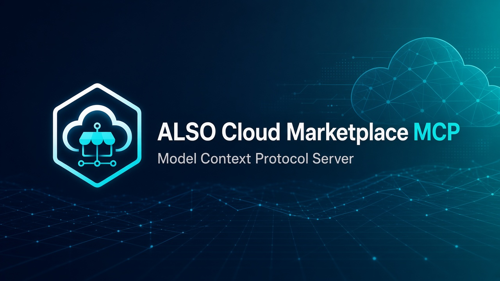
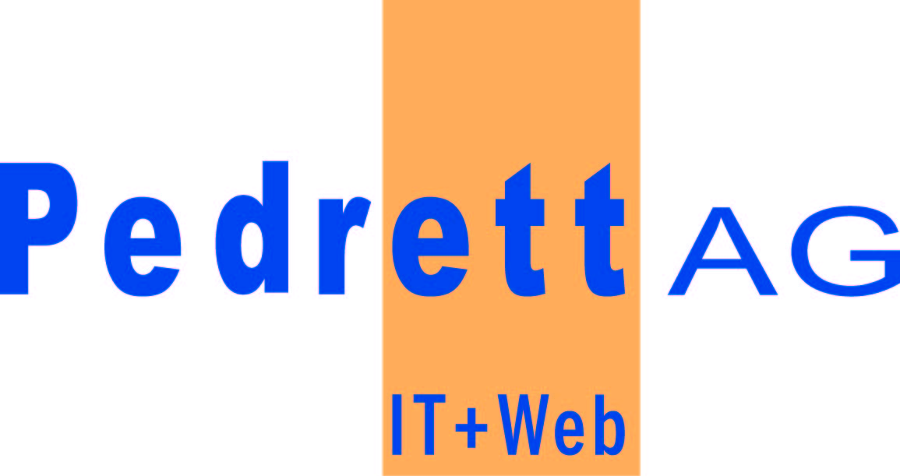

<p align="center">
  
</p>

<p align="center">
  
</p>

<h1 align="center">ALSO Cloud Marketplace MCP</h1>

<p align="center">
  <strong>Model Context Protocol Server</strong> für die ALSO Cloud Marketplace Simple API<br/>
  Companies · Subscriptions · Users · Invoices · Azure RI / Savings Plans
</p>

<p align="center">
  <a href="https://modelcontextprotocol.io"></a>
  <a href="LICENSE"></a>
  <a href="https://nodejs.org"></a>
  <a href="package.json"></a>
  <a href="https://www.pitw.ch"></a>
</p>

---

## Überblick

Dieser MCP-Server verbindet KI-Assistenten (Cursor, Claude, Gemini CLI, Codex, …) mit der [ALSO Cloud Marketplace Simple API](https://app.swaggerhub.com/apis-docs/MarketplaceSimpleAPI/MarketplaceSimpleAPI/1.0.0). Natürlichsprachliche Anfragen werden in API-Aufrufe übersetzt — lokal über stdio, mit denselben Auth- und Marketplace-Regeln wie der [go-also-cloud-wrapper](https://github.com/pitwch/go-also-cloud-wrapper).

| | |
|---|---|
| **Protokoll** | [Model Context Protocol](https://modelcontextprotocol.io) (stdio) |
| **API** | MarketplaceSimpleAPI 1.0.0 |
| **Stack** | TypeScript · Node.js 20+ |
| **Tools** | ~60 Endpoints + Workflow-Tools |

### Highlights

- Workflow-Tools für typische Reseller-Fragen (`find_companies`, `list_company_subscriptions`, …)
- Kompakte Antworten standardmässig — Rohdaten nur mit `fullDetail=true`
- Azure RI / Savings Plans inkl. Katalog-Enums und Bestell-Probelauf
- Lesbare ALSO-Fehler inkl. Support-Token bei 500ern
- Escape Hatches: `api_read` / `api_request` für selten genutzte Endpoints

---

## Inhaltsverzeichnis

- [Schnellstart](#schnellstart)
- [Konfiguration](#konfiguration)
- [Installation in Clients](#installation-in-clients)
- [Verwendung](#verwendung)
- [Tools](#tools)
- [Entwicklung](#entwicklung)
- [Links](#links)
- [Lizenz & Anbieter](#lizenz--anbieter)

---

## Schnellstart

```bash
git clone https://github.com/pitwch/also-cloud-marketplace-mcp.git
cd also-cloud-marketplace-mcp
npm install
npm run build
```

Anschliessend Credentials setzen (siehe [Konfiguration](#konfiguration)) und den Server in deinem MCP-Client eintragen.

**Empfohlener Start (gebaut):**

```text
command: node
args:    [<REPO>/dist/index.js]
```

**Alternative ohne Build (tsx):**

```text
command: npx
args:    [tsx, <REPO>/src/index.ts]
```

Voraussetzung für tsx: zuvor `npm install` im Repo.

---

## Konfiguration

| Variable | Beispiel | Pflicht |
|----------|----------|---------|
| `ALSO_CLOUD_MARKETPLACE` | `Switzerland` oder `https://marketplace.also.ch` | ja |
| `ALSO_CLOUDUSER` | `you@example.com` | ja |
| `ALSO_CLOUDPW` | `••••••••` | ja |
| `ALSO_CLOUD_TIMEOUT_MS` | `30000` | nein |
| `ALSO_CLOUD_API_PREFIX` | `/SimpleAPI/.../rest` | nein |
| `ALSO_CLOUD_PARENT_ACCOUNT_ID` | `123456` | nein |
| `ALSO_CLOUD_ALLOW_REMOTE_PRICING` | `false` | nein |

`ALSO_CLOUD_MARKETPLACE` akzeptiert eine **volle URL** oder einen **Country-Key**: `Switzerland`, `Germany`, `Austria`, `Debug`, …

Ohne `ALSO_CLOUD_PARENT_ACCOUNT_ID` wird der eigene Account automatisch erkannt (`get_my_account`).

`ALSO_CLOUD_ALLOW_REMOTE_PRICING` nur setzen, falls ALSO RI/Savings-Plan-Bestellungen über die Simple API freischaltet — sonst leiten `validate_subscription_fields` / `create_subscription` zu `order_azure_reservation` um.

### Hinweis: 2FA

ALSO-Cloud-Accounts haben **standardmässig 2FA**. Die Simple API und dieses MCP unterstützen nur Benutzername + Passwort. Für API-/MCP-Nutzung muss 2FA für den Account über das **ALSO Supportportal** deaktiviert werden.

---

## Installation in Clients

Überall gilt: Server lokal starten (stdio), Credentials als `env` setzen.  
`<REPO>` durch deinen Clone ersetzen, z. B. `C:/DEV/also-cloud-marketplace-mcp`.

<details>
<summary><strong>Cursor</strong></summary>

1. **Settings → MCP → Add new MCP server** (oder `mcp.json` bearbeiten)
2. Eintrag hinzufügen:

```json
{
  "mcpServers": {
    "also-cloud": {
      "command": "node",
      "args": ["C:/DEV/also-cloud-marketplace-mcp/dist/index.js"],
      "env": {
        "ALSO_CLOUD_MARKETPLACE": "Switzerland",
        "ALSO_CLOUDUSER": "you@example.com",
        "ALSO_CLOUDPW": "your-password"
      }
    }
  }
}
```

3. Server aktivieren / Cursor neu laden
4. Im Chat Tools von `also-cloud` nutzen, z. B. *„Liste Companies unter Parent 12345“*

</details>

<details>
<summary><strong>Claude Desktop</strong></summary>

1. Config öffnen: **Settings → Developer → Edit Config**
   - macOS: `~/Library/Application Support/Claude/claude_desktop_config.json`
   - Windows: `%APPDATA%\Claude\claude_desktop_config.json`
2. Gleichen `mcpServers`-Block wie bei Cursor einfügen
3. Claude Desktop **vollständig neu starten**
4. Im Chat das Tools-Icon prüfen — `also-cloud` sollte erscheinen

</details>

<details>
<summary><strong>Claude Code (CLI)</strong></summary>

```bash
claude mcp add also-cloud \
  --env ALSO_CLOUD_MARKETPLACE=Switzerland \
  --env ALSO_CLOUDUSER=you@example.com \
  --env ALSO_CLOUDPW=secret \
  -- node /path/to/also-cloud-marketplace-mcp/dist/index.js

claude mcp list
```

</details>

<details>
<summary><strong>Gemini CLI</strong></summary>

Config in `~/.gemini/settings.json` (oder `.gemini/settings.json`):

```json
{
  "mcpServers": {
    "also-cloud": {
      "command": "node",
      "args": ["/path/to/also-cloud-marketplace-mcp/dist/index.js"],
      "env": {
        "ALSO_CLOUD_MARKETPLACE": "Switzerland",
        "ALSO_CLOUDUSER": "you@example.com",
        "ALSO_CLOUDPW": "your-password"
      }
    }
  }
}
```

Oder per CLI:

```bash
gemini mcp add also-cloud \
  --env ALSO_CLOUD_MARKETPLACE=Switzerland \
  --env ALSO_CLOUDUSER=you@example.com \
  --env ALSO_CLOUDPW=secret \
  -- node /path/to/also-cloud-marketplace-mcp/dist/index.js
```

Docs: [MCP servers with Gemini CLI](https://geminicli.com/docs/tools/mcp-server/) · Projekt-Hinweise: [`GEMINI.md`](./GEMINI.md)

</details>

<details>
<summary><strong>OpenAI Codex / ChatGPT Desktop</strong></summary>

Codex nutzt TOML (`~/.codex/config.toml`):

```toml
[mcp_servers.also-cloud]
command = "node"
args = ["/path/to/also-cloud-marketplace-mcp/dist/index.js"]

[mcp_servers.also-cloud.env]
ALSO_CLOUD_MARKETPLACE = "Switzerland"
ALSO_CLOUDUSER = "you@example.com"
ALSO_CLOUDPW = "your-password"
```

Oder:

```bash
codex mcp add also-cloud \
  --env ALSO_CLOUD_MARKETPLACE=Switzerland \
  --env ALSO_CLOUDUSER=you@example.com \
  --env ALSO_CLOUDPW=secret \
  -- node /path/to/also-cloud-marketplace-mcp/dist/index.js

codex mcp list
```

In der TUI zeigt `/mcp` verbundene Server.  
Docs: [OpenAI MCP / Codex](https://learn.chatgpt.com/docs/extend/mcp)

</details>

<details>
<summary><strong>VS Code (GitHub Copilot)</strong></summary>

Analog zu Cursor: MCP-Server mit `command` / `args` / `env` eintragen, Pfad auf `dist/index.js` setzen und Credentials hinterlegen.

</details>

<details>
<summary><strong>Browser (ChatGPT, Gemini, Perplexity) — MCP SuperAssistant</strong></summary>

Für Web-Clients ohne natives lokales MCP eignet sich [MCP SuperAssistant](https://mcpsuperassistant.ai/) (Browser-Extension + lokaler Proxy).

1. Extension installieren: [Chrome Web Store](https://chromewebstore.google.com/detail/mcp-superassistant/kngiafgkdnlkgmefdafaibkibegkcaef)
2. `config.json` mit dem `also-cloud`-Block anlegen (wie bei Cursor)
3. Proxy starten:

```bash
npx -y @srbhptl39/mcp-superassistant-proxy@latest --config ./config.json --outputTransport sse
```

Default-URL: `http://localhost:3006/sse`

4. Im Browser: MCP-Sidebar → Connect → Instructions einfügen → Tools nutzen

</details>

---

## Verwendung

Nach der Anbindung natürlichsprachlich fragen:

| Frage | Tool |
|-------|------|
| *„Subscriptions der Demo AG?“* | `list_company_subscriptions` |
| *„Alle Azure-/VM-Subscriptions / RI-Optimierung“* | `list_azure_subscriptions` |
| *„Finde Company Demo“* | `find_companies` |
| *„Reservation der Demo AG tauschen“* | `get_reservation_options` |
| *„Was ist meine Parent-ID?“* | `get_my_account` |
| *„Companies unter Parent 523525“* | `get_companies` |
| *„Latest Invoices für März 2026“* | `get_latest_invoices_for_period` |
| *„User unter Company X anlegen“* | `create_user` |

**Tipp:** Für Firmen-/Abo-Fragen die Workflow-Tools nutzen — nicht Reports oder Marketplaces. Subscription-Tools liefern standardmässig **kompakte** Antworten; Rohdaten nur mit `fullDetail=true`.

Discovery aller API-Endpoints: `list_api_endpoints`.

---

## Tools

~60 Tools. Vollständige Liste inkl. Risiko-Flags: **`list_api_endpoints`**.

### Empfohlene Workflows

| Tool | Zweck |
|------|--------|
| `find_companies` | Firma nach Name unter Parent suchen |
| `list_company_subscriptions` | Aktive/kompakte Subscriptions einer Firma |
| `list_azure_subscriptions` | Azure Plan / RI / Savings Plan (Portfolio) |
| `get_reservation_options` | Tausch-/Änderungs-/Renew-Optionen (read-only) |
| `get_my_account` | Eigener Account = Default-`parentAccountId` |

### Session & Meta

| Tool | Zweck |
|------|--------|
| `list_marketplaces` | Country-Keys → Base-URLs (ohne Login) |
| `list_api_endpoints` | Katalog der Simple-API |
| `validate_session` / `clear_session` | Session prüfen / verwerfen |
| `order_azure_reservation` | RI / Savings Plans über Portal-API (Dry-Run standard; `confirmOrder=true` bestellt) |
| `get_remote_enums` | Auswahlwerte (SKU, Region, Segment, …) kaskadierend |
| `api_read` | Read-only Escape Hatch für `Get*`/`List*` ohne eigenes Tool |
| `api_request` | Escape Hatch für Schreib-/destruktive Endpoints |

### Lesen

| Bereich | Tools |
|---------|--------|
| Company / Reseller / Dept / User | `get_*`, `get_*_by_vat_id`, Listen |
| Subscriptions | `get_subscription(s)`, `get_subscription_with_addons`, `get_possible_services_for_parent` |
| Catalog | `get_owned_marketplaces`, `list_marketplace_services`, `get_available_services_for_marketplace`, `get_service_information` |
| Billing | `get_reports`, `execute_report`, `get_latest_invoices*`, `get_preview_invoices`, `get_invoice_aggregation_report` |
| Sonst | `get_credit_limit`, `get_security_roles`, `get_special_deal` |

### Schreiben

| Bereich | Tools |
|---------|--------|
| Accounts | `create_*` / `update_*` für Company, Reseller, Department, User |
| Subscriptions | `get_fields_for_service`, `validate_subscription_fields`, `create_subscription`, `update_subscription` |
| Actions | `get_account_custom_actions`, `execute_account_custom_action`, `retry_last_failed_provisioning` |
| Upgrade / Renew | `get_possible_services_for_upgrade`, `get_subscription_fields_for_*`, `execute_subscription_upgrade`, `configure_subscription_renew`, `reset_default_renew_values` |
| Credit / Deal | `set_credit_limit`, `list_credit_check_orders_for_approval`, `approve_*` / `decline_credit_check_order`, `set_special_deal` |

### Nur über `api_request`

Destruktive / seltene Endpoints (`TerminateAccount`, `DeleteMarketplace*`, …) haben bewusst **kein** eigenes Tool — damit die KI sie nicht versehentlich aufruft.

---

## Entwicklung

```bash
npm run dev        # stdio via tsx
npm run typecheck
npm run build
npm start          # node dist/index.js
```

**Wichtig:** Auf stdout nur MCP-JSON-RPC schreiben — Logs ausschliesslich mit `console.error`.

---

## Links

| Ressource | URL |
|-----------|-----|
| Repository | https://github.com/pitwch/also-cloud-marketplace-mcp |
| Go-Wrapper | https://github.com/pitwch/go-also-cloud-wrapper |
| Swagger / API | https://app.swaggerhub.com/apis-docs/MarketplaceSimpleAPI/MarketplaceSimpleAPI/1.0.0 |
| MCP Spec | https://modelcontextprotocol.io |
| Anbieter | https://www.pitw.ch |

---

## Lizenz & Anbieter

MIT License — siehe [`LICENSE`](./LICENSE).

<br/>

<p align="center">
  <a href="https://www.pitw.ch">
    
  </a>
</p>

<p align="center">
  <strong>Entwickelt und bereitgestellt von</strong><br/>
  <a href="https://www.pitw.ch"><strong>Pedrett IT+Web AG</strong></a><br/>
  <a href="https://www.pitw.ch">www.pitw.ch</a>
</p>

<p align="center">
  <sub>Murgtalstrasse 20 · 9542 Münchwilen TG · Schweiz · <a href="mailto:info@pitw.ch">info@pitw.ch</a></sub>
</p>
